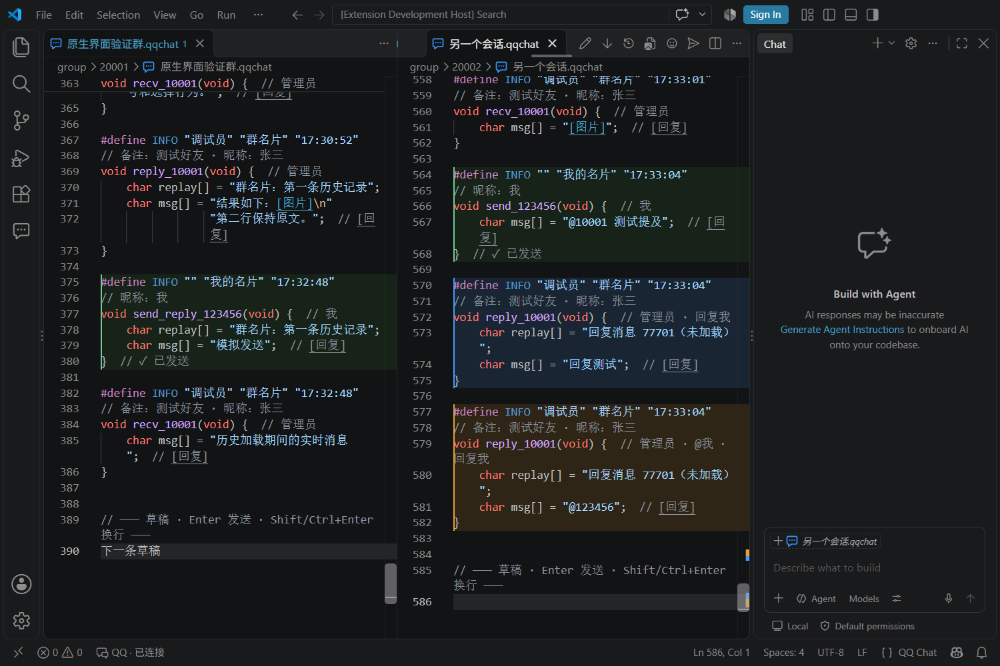
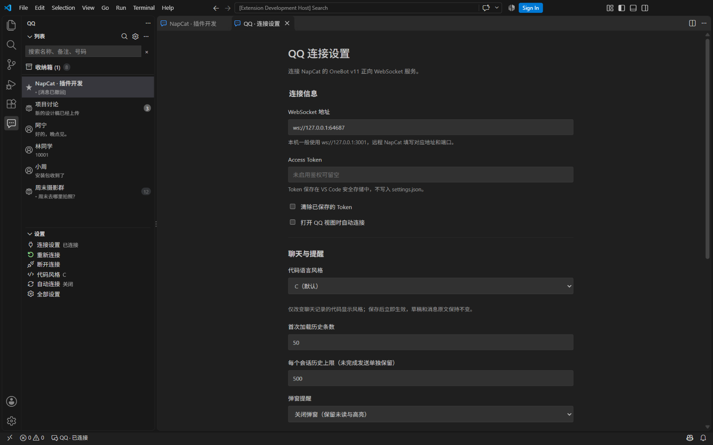
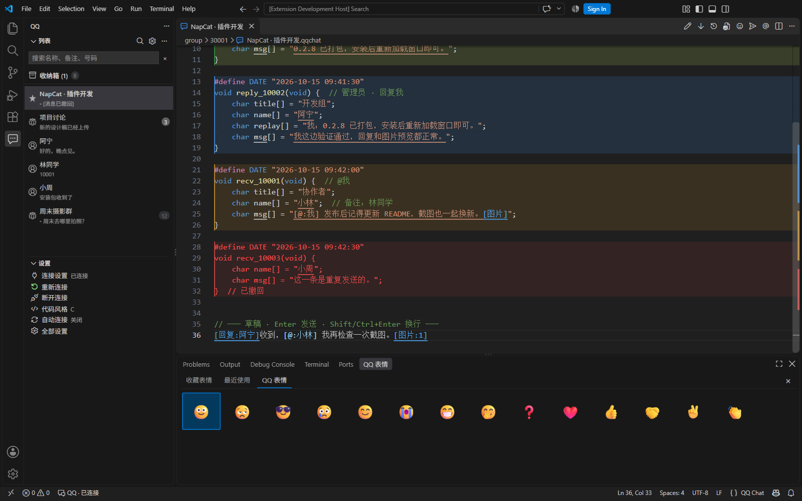

# NapCat QQ for VS Code

在 VS Code 原生编辑器里聊 QQ。基于 **NapCat / OneBot v11**，聊天记录以 C 风格代码显示，底部直接写草稿，沿用编辑器的字体、主题、行号、查找与分屏。

- **原生聊天**：Enter 发送，Shift / Ctrl+Enter 换行；发送状态显示在消息后面。
- **消息提醒**：列表按未读置顶，支持收藏、搜索、回复、@成员和分类高亮。
- **图片与表情**：文字占位、悬浮预览、点击看大图；收藏表情与最近使用。
- **文件收发**：拖入文件、上传进度、取消排队、失败重试、下载另存为。
- **本地恢复**：独立草稿、未完成发送保存、重连补历史和附件缓存管理。

[界面预览](#界面预览) · [安装与连接](#安装与连接) · [使用教程](#使用教程) · [配置说明](#配置说明) · [常见问题](#常见问题) · [开发与依赖](#开发与依赖)

## 界面预览

以下为 **0.1.11 的实际 VS Code 测试窗口截图**，使用模拟账号和聊天内容。界面配色跟随 VS Code 主题；表情面板里的纯色缩略图是测试图片。

### 原生编辑器与消息高亮

自己发送的消息使用主题绿色，回复我显示淡蓝色，@我显示淡橙色；后两种颜色可以在设置页调整。



<details>
<summary>连接设置与上下排列的列表 / 收藏</summary>

页面提供连接地址、Token、聊天设置、高亮颜色和缓存管理。截图中的端口属于测试服务，实际连接请填写自己的 OneBot WebSocket 端口。



</details>

<details>
<summary>表情选择器与最近使用</summary>

输入 `/表情` 打开选择器，方向键选择、Enter 插入，选完自动关闭。最近使用按插入顺序排列，最多 10 个。



</details>

## 安装与连接

### 1. 准备运行环境

| 需要准备 | 用途与链接 |
| --- | --- |
| VS Code 桌面版 | 插件宿主，声明的最低版本为 1.95；[下载](https://code.visualstudio.com/) · [GitHub](https://github.com/microsoft/vscode) |
| NapCatQQ 与已登录的 QQ 账号 | 提供消息收发和联系人接口；[GitHub](https://github.com/NapNeko/NapCatQQ) · [下载版本](https://github.com/NapNeko/NapCatQQ/releases) · [官方安装文档](https://napneko.github.io/) |
| 本插件的 `.vsix` 安装包 | 可使用已有安装包，或按下文从源码生成 |

使用 VSIX 安装包时，插件的 JavaScript 依赖已经打包，**不需要另外安装 Node.js、Python 或 tuiqq**。目前主要在 Windows 桌面版 VS Code 上验证；网页版不在支持范围内。

### 2. 安装 VSIX

在 VS Code 中打开扩展视图（`Ctrl+Shift+X`），点击右上角 `…` → **从 VSIX 安装… / Install from VSIX…**，选择安装包。更新已有版本后，执行 **Developer: Reload Window / 开发人员: 重新加载窗口**。

也可以在能使用 `code` 命令的终端里安装：

```sh
code --install-extension ./artifacts/vscode-qq-0.1.12.vsix --force
```

没有安装包时，安装 Node.js 22 或更高版本及 Git，在终端执行：

```sh
git clone https://github.com/limelisest/VSCodeQQ.git
cd VSCodeQQ
npm ci
npm run build
npm run package
```

私有仓库需要先获得访问权限。打包产物位于 `artifacts/`，文件名中的版本号取自 `package.json`。开发工具及其 GitHub 地址见[开发与依赖](#开发与依赖)。

### 3. 配置 NapCat

先按 NapCat 官方文档完成安装并登录 QQ，然后在 NapCat WebUI 的**网络配置**中新建 **WebSocket 服务端（正向 WS）**，启用并保存。[官方配置说明](https://napneko.github.io/config/basic)

本机部署可采用下面的配置：

| 配置项 | 示例 / 要求 |
| --- | --- |
| 网络类型 | WebSocket 服务端（正向 WS） |
| 监听地址 | `127.0.0.1`，用于与 VS Code 同机连接 |
| 端口 | `3001`，也可以使用其他空闲端口 |
| 消息上报格式 | **array / 数组**，用于解析图片、回复和 @ 等消息段 |
| Token | 设置 OneBot 服务的鉴权 Token，连接插件时填写相同值 |
| 上报自身消息 | 按需开启，以接收其他 QQ 客户端发出的自身消息 |

连接地址对应上表时为 `ws://127.0.0.1:3001`。**NapCat WebUI 的管理地址、登录 Token，与 OneBot 服务的连接地址、Token 分开配置**，请勿把 WebUI 页面地址填入插件。

NapCat 部署在另一台机器时，填写该机器可访问的地址，并配置对应监听地址、端口映射和鉴权。插件传输图片、文件时不要求 NapCat 直接读取 VS Code 的本地路径。

### 4. 连接插件

1. 点击 VS Code 左侧的 **QQ 消息图标**。
2. 点击列表标题栏的齿轮，或通过 `Ctrl+Shift+P` 运行 **QQ: 连接设置**。
3. 填入 OneBot WebSocket 地址和 Access Token。
4. 点击 **测试连接**，确认返回正确的登录账号。
5. 点击 **保存并连接**，等待状态栏显示 `QQ · 已连接`。
6. 在列表中选择群聊或好友，在聊天文档底部草稿区输入消息。

Token 保存在 VS Code SecretStorage。编辑配置时，Token 留空表示保持原值；需要移除时勾选“清除已保存的 Token”。“测试连接”使用临时连接，不保存表单，也不切换当前聊天账号。

已有 tuiqq 配置可通过 **QQ: 导入 tuiqq 配置** 选择 `config.json`，读取 `ws_url`、`ws_token` 和历史条数；导入后再保存并连接即可。

## 使用教程

### 文字、回复与 @成员

只在底部 **草稿** 分隔线下面输入。历史消息使用 C 风格语法展示，无需自己填写函数、引号或分号。

| 操作 | 方法 |
| --- | --- |
| 发送草稿 | `Enter` |
| 换行 | `Shift+Enter` 或 `Ctrl+Enter`；macOS 为 `Cmd+Enter` |
| 回复消息 | 消息后的 `[回复]`、右键菜单，或 `Ctrl+Shift+R` |
| 取消回复 | 命令面板执行 `QQ: 取消回复` |
| @群成员 | 输入 `@` 后从补全列表选择成员 |
| 插入表情 | 输入 `/`，选择 `/表情` 或 `/emoji` |
| 插入图片 | `/图片`、编辑器工具栏图片按钮，或粘贴剪贴板图片 |
| 插入文件 | `/文件`、命令 `QQ: 插入文件`，或按住 Shift 拖入文件 |
| 复制原文 | 在消息上右键 → `QQ: 复制消息原文` |
| 回到底部 | 编辑器工具栏向下箭头，或状态栏“返回最新 / 新消息” |
| 查看更早消息 | 命令 `QQ: 加载更多记录` 或工具栏历史按钮 |

如果补全列表未自动出现，可以按 `Ctrl+Space` 手动触发。补全列表打开时，Enter 先确认当前候选项。输入法组合输入期间不会发送。

@成员插入后显示为 `@[QQ号]`，发送时转换为真实 QQ 提及。群成员列表在打开会话时加载；加载失败可重新打开会话重试。

聊天记录示例：

```c
#define CHAT_NAME "开发群"
#define GROUP_ID "123456"

#define INFO "调试员" "群名片" "12:30:01"
// 备注：好友备注 · 昵称：原昵称
void recv_10001(void) {  // 管理员
    char msg[] = "消息内容[图片]";  // [回复]
}

#define INFO "" "我的名片" "12:30:05"
void send_reply_123456(void) {  // 我
    char replay[] = "群名片：消息内容[图片]";
    char msg[] = "收到";  // [回复]
}  // ✓ 已发送
```

`INFO` 的三项分别是**群头衔、显示名称、时间**；管理员 / 群主标签放在函数行，备注和昵称按需单独显示。引号、反斜杠、换行只在展示时进行转义，复制原文和发送使用实际消息内容。

### 图片与表情

收到的图片默认显示为高亮 `[图片]`。鼠标悬浮时等比例预览，通常限制在 240×160 内，窗口较矮时进一步缩小；通过链接手势（通常 Ctrl+单击）或悬浮窗中的“打开大图”进入 VS Code 图片预览。

复用聊天记录中的图片：悬浮在 `[图片]` 上，点击 **引用到发送栏**；也可以把光标放到该图片占位符上，右键选择 **QQ: 图片引用到发送栏**。图片会作为新的 `[图片:序号]` 插入本会话草稿；光标在历史区时追加到草稿末尾。已有文字和回复对象保留，按 Enter 才发送。回复的 `char replay[]` 中的图片同样支持预览、打开大图和引用到发送栏；原消息尚未加载时显示未加载提示。

发送图片时，先在草稿中插入占位符，例如：

```text
这是修改前的截图：[图片:1]
这是修改后的截图：[图片:2]
```

发送顺序与占位符在文字中的顺序一致。删除占位符就不会发送该附件；重复放置同一个占位符会重复发送。不要手动编造没有导入过的占位符。

表情面板提供：

- **收藏表情**：默认打开，读取当前 QQ 账号的收藏表情，支持刷新和加载更多。
- **最近使用**：按最近插入顺序去重，最多 10 个，按账号保存。
- **QQ 表情**：内置常用表情入口。

方向键选择、Enter 插入、Esc 返回草稿。选完会自动关闭面板，**选择表情本身不会发送消息**；回到草稿后按 Enter 才发送。收藏表情作为图片表情发送，GIF 保持原文件。

### 文件发送与下载

1. 输入 `/文件` 选择文件，或按住 **Shift** 从本机文件管理器拖到草稿区。
2. 等待出现 `[文件:文件名]` 占位符，悬浮可查看大小；文件夹请先压缩。
3. 按 Enter 后草稿立即清空，聊天记录中出现待发送消息。
4. 观察该条消息结束花括号后的进度、已传大小和平均速度。

同名文件的占位符自动加序号，上传文件名保持原样。文字、图片和文件混排时，文件会拆成独立消息，按原顺序依次发送；文件上传接口不携带引用，回复只用于文字 / 图片消息。

| 状态 | 含义与操作 |
| --- | --- |
| 等待发送 | 排在同一会话前面的消息之后，可点 `[取消]` |
| 上传到 NapCat | 显示分片回执进度，可取消尚未提交给 QQ 的文件 |
| 等待 QQ 确认 | 文件已传至 NapCat，等待最终上传接口返回；此时不提供取消 |
| 已发送 | 收到成功回执 |
| 发送失败 | 点 `[重试]` 仅重试这一项 |
| 结果未确认 | 可能已经送达，先检查记录再决定是否重试 |

上传到 NapCat 的 **100% 不等于 QQ 已确认送达**。最终 QQ 上传阶段没有连续百分比。失败后重试文件会重新传输该文件，不重发相邻的成功消息。

接收文件时，点击文件消息的 `[文件:名称]` 链接或悬浮操作，选择保存位置。下载完成后可打开所在文件夹。取消或下载失败时不覆盖目标文件；链接过期或后端接口不可用时会提示原因。

### 列表、收藏、未读与高亮

左侧是**上下排列的两个可折叠列表**：上方“列表”包含好友和群聊，下方“收藏”显示收藏会话。右键会话可收藏、标记已读或忽略未读。

两个列表都按**有效未读置顶，再按最近消息时间**排序。点击搜索图标可匹配群名、好友备注、昵称和号码；空格分隔多个关键词，Enter 保留筛选，Esc 取消，标题栏 × 清除。

| 消息类型 | 显示方式 |
| --- | --- |
| 自己发送 | 当前主题的绿色新增行底色与边线 |
| @我（含全体成员） | 默认淡橙色；标签显示 `@` |
| 回复我 | 默认淡蓝色；标签显示 `↩` |
| 普通未读 | 标签显示未读数量 |

同时 @我和回复我时，优先显示 @我颜色；**已读后仍保留消息高亮**。可以在 QQ 设置页修改两种提醒色和弹窗范围。

群聊普通未读只列入 QQ 设置为“接收并提醒”的会话；免打扰群的 @我和回复我仍作为例外提醒。手动“忽略未读”的会话全部静默。好友的 QQ 免打扰状态暂无法同步，可使用本地“忽略未读”。

收到新消息和自动置底不会直接清除未读；主动打开会话、在底部操作聊天或标记已读后清除。未读状态仅在插件本地统计，不与 QQ 手机端同步。

### 自动跟随与恢复

在底部阅读或输入时，新消息到达会继续置底并保留草稿和选区。手动上翻后暂停跟随，状态栏显示新消息数量；点击返回最新后恢复跟随。加载更早历史时保持阅读位置。

- 每个会话独立保存草稿；未完成发送独立保留，不受普通历史条数上限影响。
- 重载窗口后，未完成发送标为“结果未确认”，不会自动重发。
- 误删历史或分隔线时会自动修复，只保留草稿区域的有效编辑。`Ctrl+S` 只保存，不发送。
- 必要时执行 `QQ: 重建聊天文档（恢复已缓存草稿）`。
- 断线自动重连；重连后补拉已打开及最近 20 个有消息的会话，每个会话最多拉取配置的历史上限，并按 ID 去重。

## 配置说明

点击 QQ 列表或收藏标题栏的齿轮，进入连接设置页。这里可以修改连接、通知、高亮、历史条数，查看附件缓存占用并清理无用副本；也可以在 VS Code 设置中搜索 `qq`。

| 配置 | 默认值 | 说明 |
| --- | --- | --- |
| `qq.wsUrl` | `ws://127.0.0.1:3001` | OneBot v11 正向 WebSocket 地址 |
| `qq.autoConnect` | `true` | 插件激活时自动连接 |
| `qq.historyCount` | `50` | 初次读取历史数量，10～500 |
| `qq.messageLimit` | `500` | 每个会话普通历史上限，50～2000；未完成发送另行保留 |
| `qq.notifications` | `all` | 弹窗范围：`all` / `mentions` / `off` |
| `qq.mentionColor` | `#E5A030` | @我高亮色，背景自动淡化 |
| `qq.replyColor` | `#409CFF` | 回复我高亮色，背景自动淡化 |
| `qq.cacheRetentionDays` | `7` | 无引用附件保留天数，1～90 |

消息、草稿、收藏及媒体保存在 VS Code 插件全局存储目录中，按账号隔离。无引用附件按小时清理，保护草稿、有限撤销记录、未完成发送和历史图片引用；最近一小时导入的附件也有保护期。图片媒体缓存另按 128 MB / 7 天清理。

插件运行于**本机 UI 扩展宿主**。打开 WSL / SSH 工程时，连接地址中的 `127.0.0.1` 仍表示运行桌面 VS Code 的机器。

## 常见问题

### 连接失败或一直没有会话列表

确认 NapCat 已登录 QQ，启用的是 **WebSocket 服务端**，端口和 OneBot Token 与插件一致；消息上报格式选择 `array`。先使用“测试连接”，再“保存并连接”。详细错误可在 VS Code **输出 → QQ** 查看。初始化失败会自动退避重试。

### 点击图片、回复或取消按钮没有反应

这些是原生编辑器文档链接，使用 VS Code 的链接打开手势，通常为 **Ctrl+单击**；也可悬浮后操作。回复还可以使用右键菜单或 `Ctrl+Shift+R`。

### 图片或收藏表情显示失败

先检查 NapCat 连接和图片地址是否可访问，再刷新表情列表；加载失败的表情格子可以点击重试。插件会尝试通过后端重新获取图片地址，已过期或被删除的媒体可能无法恢复。

### 文件上传提示接口不可用

文件发送使用 NapCat 的 `upload_file_stream` 及群 / 私聊上传接口，需要后端支持这些能力。请按 [NapCat 文件处理文档](https://napneko.github.io/develop/file) 检查版本与配置。普通 OneBot v11 实现不一定支持本插件用到的 NapCat 扩展接口。

### 大小限制和暂未支持的内容

- 图片：单张及单条消息图片总大小上限为 **16 MB**，每条最多 **8 个附件**。
- 文件：插件不另设大小上限，实际受 QQ / NapCat、群空间和可用磁盘限制；导入会复制到本地缓存。
- 历史：读取范围受配置上限和后端可提供的记录限制，长时间断线不保证完整补齐。
- 语音、视频、合并转发等内容目前显示为文字占位；不提供完整 QQ 客户端的全部功能。

## 开发与依赖

### 项目与依赖 GitHub

运行插件需要 VS Code 和已登录的 NapCat；下列 npm 库由构建流程安装并打包，使用者无需逐个下载。

| 项目 / 依赖 | 用途 | GitHub |
| --- | --- | --- |
| NapCatQQ | QQ 后端，提供 OneBot 与扩展接口 | [NapNeko/NapCatQQ](https://github.com/NapNeko/NapCatQQ) |
| VS Code | 原生编辑器、扩展 API 和界面宿主 | [microsoft/vscode](https://github.com/microsoft/vscode) |
| OneBot 11 | 通讯协议规范，无需单独安装 | [botuniverse/onebot-11](https://github.com/botuniverse/onebot-11) |
| Node.js | 源码构建与测试环境，使用 Node.js 22+ | [nodejs/node](https://github.com/nodejs/node) |
| ws | WebSocket 客户端 | [websockets/ws](https://github.com/websockets/ws) |
| image-size | 读取图片尺寸，计算悬浮预览比例 | [image-size/image-size](https://github.com/image-size/image-size) |
| TypeScript | 类型检查 | [microsoft/TypeScript](https://github.com/microsoft/TypeScript) |
| esbuild | 打包插件和测试入口 | [evanw/esbuild](https://github.com/evanw/esbuild) |
| @vscode/vsce | 生成 VSIX 安装包 | [microsoft/vscode-vsce](https://github.com/microsoft/vscode-vsce) |
| DefinitelyTyped | Node.js、VS Code 和 ws 类型声明 | [DefinitelyTyped/DefinitelyTyped](https://github.com/DefinitelyTyped/DefinitelyTyped) |

`image-size` 的 GitHub 仓库已归档，维护地址为 [Codeberg](https://codeberg.org/image-size/image-size)。依赖版本以 [package.json](package.json) 和 [package-lock.json](package-lock.json) 为准；第三方声明见 [THIRD_PARTY_NOTICES.txt](THIRD_PARTY_NOTICES.txt)。

### 构建与测试

```sh
npm ci
npm run build
npm test
npm run test:extension
npm run package
```

- `build`：TypeScript 类型检查并生成 `dist/`。
- `test`：单元测试，运行前需要先构建。
- `test:extension`：打开独立 VS Code 测试窗口，连接模拟 NapCat，不向真实 QQ 联系人发送消息；报告和截图写入 `.test-output/`。需要桌面环境及可启动的 VS Code，可用 `VSCODE_EXECUTABLE` 指定可执行文件。
- `package`：将已有构建打包到 `artifacts/`，修改代码后先重新运行 `build`。

构建后，在 VS Code 打开本仓库，按 F5 启动扩展开发窗口。Windows 默认用户安装路径可使用 `node scripts/install-extension.cjs` 安装并校验本地 VSIX；其他路径使用 VS Code 的“从 VSIX 安装”入口。

使用已有 tuiqq 配置进行真实 NapCat 的只读验证：

```sh
node dist/test/live.cjs "path/to/tuiqq/config.json"
```

脚本不发送消息，结果写入 `.test-output/live-result.json`。请勿将包含 Token 的本地配置提交到仓库。

## 许可证

本插件采用 [MIT](LICENSE) 许可证。NapCat 及其他依赖遵循各自项目的许可证。
